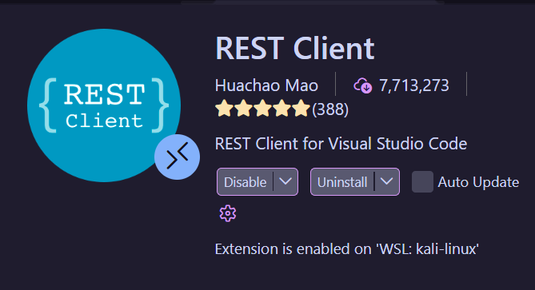
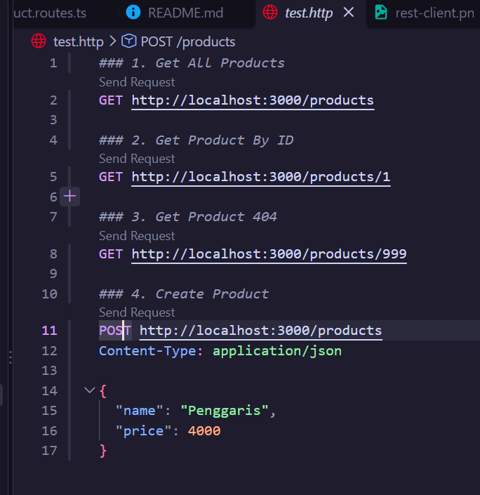
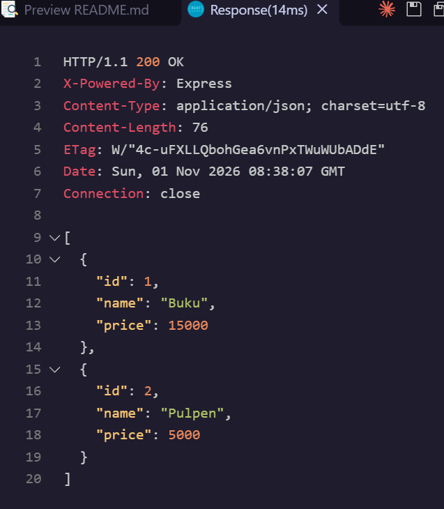
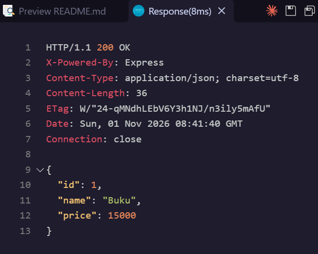
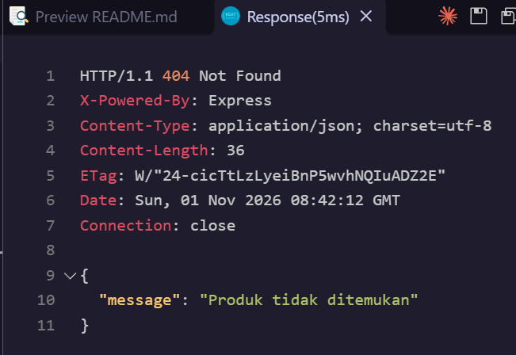
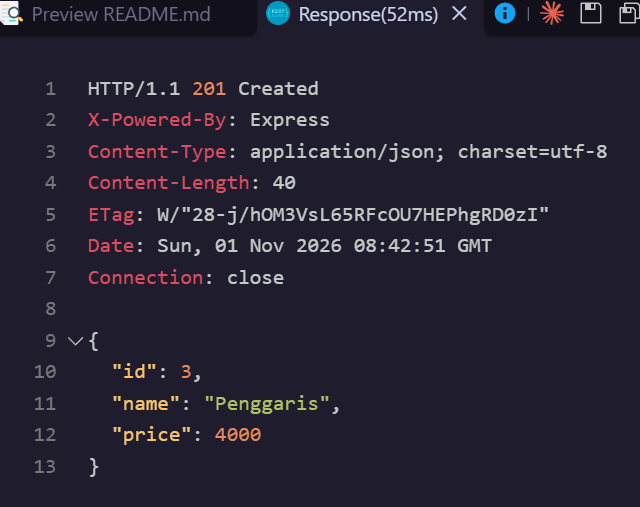

# Petunjuk Menjalankan dan Daftar Endpoint

jalankan

```bash
npm install
npm run dev
```

di dalam folder `/express_demo-pemweb`

masuk ke `http://localhost:3000/products` di browser

Untuk melakukan testing, kalau menggunakan vscode, install extension rest client.



lalu buka `test.http`



extension rest client mempermudah kita untuk melakukan request ke website kita apabila melakukan development di vs code. Karena tidak perlu keluar dari vs code.

klik tombol send request dari ### 1 sampai ### 4. 

### output send request ### 1



### output send request ### 2



### output send request ### 3



### output send request ### 4



## Daftar Endpoint

| Method | Endpoint | Request Body | Status Code | Deskripsi |
| :--- | :--- | :--- | :---: | :--- |
| `GET` | `/products` | - | `200 OK` | Mengambil seluruh daftar produk |
| `GET` | `/products/:id` | - | `200 OK` / `404 Not Found` | Mengambil data produk berdasarkan ID |
| `POST` | `/products` | `{"name": "...", "price": ...}` | `201 Created` / `400 Bad Request` | Menambahkan produk baru |
| `GET` | `/hello` | - (Query param: `?nama=...`) | `200 OK` | Endpoint demo greeting |
